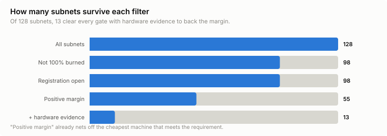
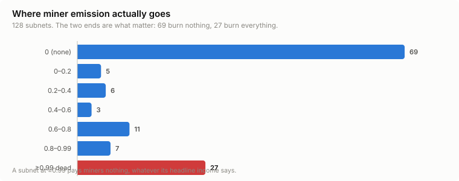
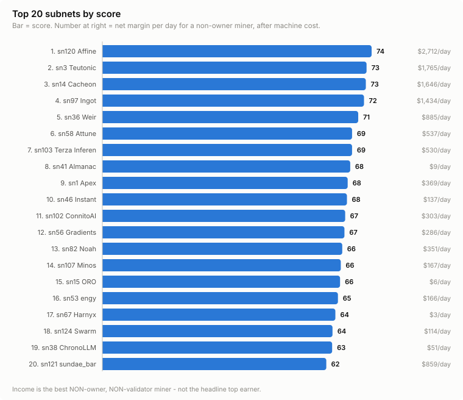

# Subnet watch — dashboard

_snapshot 2026-11-07T00:52:09Z · block 9450753 · run_status **ok**_

> Numbers here are quotable. Income is always `competitive_miner_usd_day` —
> the best miner that is neither the owner nor validator-permitted.

## The one number

# 63 of 128

subnets are worth looking at: not 100% burned, registration open, and the
competitive miner out-earns the cheapest machine that meets the requirement.

| | count | meaning |
|---|---:|---|
| Total subnets | 128 | everything on chain |
| Pays miners at all | 102 | `miner_burn` < 0.99 |
| Ranked | 102 | passed every gate |
| **Positive margin** | **63** | income beats machine cost |
| New events this window | 6 | see ALARMS.md |

## Where miner emission goes

The distribution is bimodal — subnets either burn nothing or burn everything.
There is very little middle ground, which is why burn is a gate and not a score.

| miner_burn | subnets | |
|---|---:|---|
| 0 (none) | 71 | `████████████████████████████` |
| 0–0.2 | 5 | `██` |
| 0.2–0.4 | 4 | `██` |
| 0.4–0.6 | 7 | `███` |
| 0.6–0.8 | 10 | `████` |
| 0.8–0.99 | 5 | `██` |
| ≥0.99 dead | 26 | `██████████` |

## Top 20

| # | subnet | score | net $/day (median) | ceiling $/day | machine | earners | top-1 share |
|---:|---|---:|---:|---:|---|---:|---:|
| 1 | sn120 Affine | 74.4 | 2,776 | 2,776 = | rtx4090* | 10 | 10% |
| 2 | sn3 Teutonic | 72.9 | 1,753 | 3,515 | rtx4090* | 7 | 25% |
| 3 | sn14 Cacheon | 72.8 | 1,726 | 4,147 | rtx4090* | 3 | 68% |
| 4 | sn36 Weir | 69.5 | 648 | 1,267 | rtx4090* | 9 | 24% |
| 5 | sn58 Attune | 69.1 | 571 | 919 | rtx4090* | 5 | 70% |
| 6 | sn41 Almanac | 69.1 | 10.79 | 152 | cpu-small | 176 | 5% |
| 7 | sn56 Gradients | 68.8 | 512 | 3,315 | rtx4090* | 7 | 35% |
| 8 | sn103 Terza Inference | 68.2 | 433 | 938 | rtx4090* | 5 | 37% |
| 9 | sn1 Apex | 67.4 | 342 | 783 | rtx4090* | 4 | 71% |
| 10 | sn46 Instant | 67.4 | 133 | 204 | cpu-small | 9 | 46% |
| 11 | sn67 Harnyx | 66.8 | 5.19 | 237 | cpu-small | 127 | 13% |
| 12 | sn82 Noah | 66.7 | 344 | 424 | rtx4090* | 64 | 2% |
| 13 | sn15 ORO | 66.5 | 6.93 | 13.91 | cpu-small | 70 | 96% |
| 14 | sn107 Minos | 65.9 | 172 | 14,638 | cpu-small | 20 | 80% |
| 15 | sn38 ChronoLLM | 62.7 | 43.69 | 391 | cpu-small | 10 | 52% |
| 16 | sn66 conjectures | 61.1 | 51.80 | 142 | rtx4090* | 5 | 80% |
| 17 | sn62 Ridges | 61.1 | 51.46 | 1,067 | rtx4090* | 39 | 22% |
| 18 | sn55 NIOME | 60.9 | 49.22 | 423 | rtx4090* | 11 | 30% |
| 19 | sn97 Ingot | 60.5 | 1,499 | 1,499 = | rtx4090* | 5 | 20% |
| 20 | sn117 everyframe.studi | 59.8 | 35.13 | 203 | rtx4090* | 27 | 64% |

`=` after the ceiling means it equals the median exactly - either one competitive
miner exists, or they all earn the same. Both columns use identical precision;
if they ever disagree the data is wrong, since a median cannot exceed its own max.

`net $/day (median)` is what a newcomer should expect: the MEDIAN non-owner,
non-permitted miner, minus machine cost. `ceiling $/day` is the BEST competitive
miner - reachable only by beating everyone already there. Where the two diverge
wildly, the subnet is winner-take-all and the ceiling is not a plan.

`*` = machine is an assumed default; no hardware evidence was found for that subnet.

## Concentration — reported, never scored

A low top-1 share means many miners share the emission. A high one means a
single UID takes almost everything, so the headline income is not reachable.
**This is deliberately excluded from the score** — judge the shape yourself.

| top-1 share | subnets (of those that pay) |
|---|---:|
| wide (<30%) | 31 |
| concentrated (30–60%) | 18 |
| dominated (60–90%) | 28 |
| captured (>90%) | 24 |

## Hardware evidence quality

Most subnets do not state a requirement anywhere machine-readable, so their
margin assumes a default box. Treat those as indicative.

| basis | subnets |
|---|---:|
| no evidence | 99 |
| README keywords (GUESS) | 11 |
| min_compute.yml (curated) | 9 |
| code-submission (validator runs it) | 8 |
| README stated VRAM (explicit) | 1 |

## Recent changes (last 7 days)

| when | subnet | class | what |
|---|---|---|---|
| 2026-11-07T00:52 | sn2 | SCORING_COMMIT | sn2 commit touches scoring: Publish operator-focused SN2 validator doc |
| 2026-11-07T00:52 | sn66 | RELEASE | sn66 released v2026.11.06.3 |
| 2026-11-07T00:52 | sn66 | SCORING_COMMIT | sn66 commit touches scoring: Bound archive validation resources and en |
| 2026-11-07T00:52 | sn71 | SCORING_COMMIT | sn71 commit touches scoring: Test historical verifier finality with it |
| 2026-11-07T00:52 | sn116 | SCORING_COMMIT | sn116 commit touches scoring: Queue view: a GET never slows a grade (V |
| 2026-11-07T00:52 | sn120 | SCORING_COMMIT | sn120 commit touches scoring: Clarify independent 64K gate limits in m |
| 2026-11-06T20:59 | sn2 | SCORING_COMMIT | sn2 commit touches scoring: Prepare Finney SN2 validator onboarding an |
| 2026-11-06T20:59 | sn14 | SCORING_COMMIT | sn14 commit touches scoring: Release reward priority after completed w |
| 2026-11-06T20:59 | sn28 | RELEASE | sn28 released v0.5.22 |
| 2026-11-06T20:59 | sn28 | README_TASK_DIFF | sn28 README task/scoring sections changed |
| 2026-11-06T20:59 | sn71 | SCORING_COMMIT | sn71 commit touches scoring: Preserve consumed redirect provenance and |
| 2026-11-06T20:59 | sn88 | README_TASK_DIFF | sn88 README task/scoring sections changed |
| 2026-11-06T20:59 | sn104 | SCORING_COMMIT | sn104 commit touches scoring: fix(validator): sync live operational fi |
| 2026-11-06T20:59 | sn108 | SCORING_COMMIT | sn108 commit touches scoring: Validator requirements: 500 GB SSD recom |
| 2026-11-06T20:59 | sn116 | SCORING_COMMIT | sn116 commit touches scoring: Dashboard Updates page (miner Updates),  |

---

_Regenerated every sweep. Charts are SVG and follow the same numbers._

