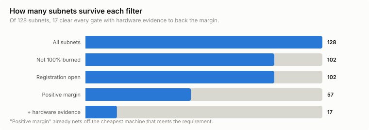
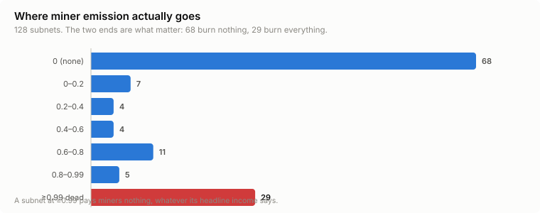
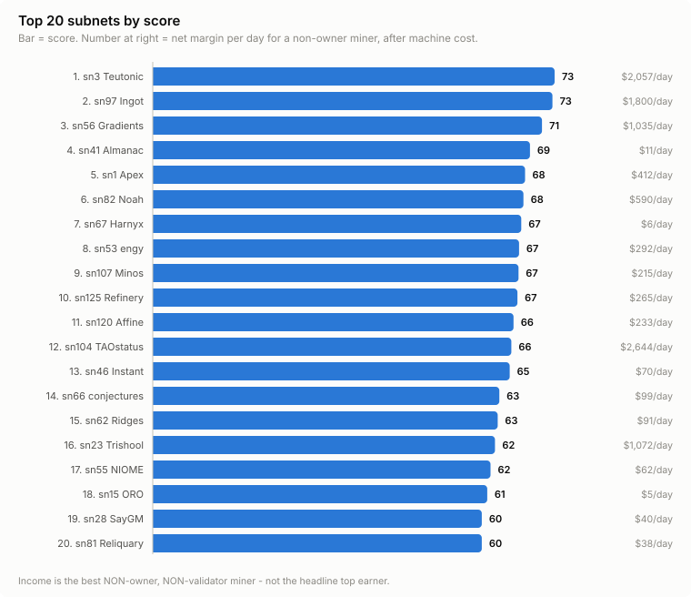

# Subnet watch — dashboard

_snapshot 2026-10-12T02:33:26Z · block 9264150 · run_status **ok**_

> Numbers here are quotable. Income is always `competitive_miner_usd_day` —
> the best miner that is neither the owner nor validator-permitted.

## The one number

# 58 of 128

subnets are worth looking at: not 100% burned, registration open, and the
competitive miner out-earns the cheapest machine that meets the requirement.

| | count | meaning |
|---|---:|---|
| Total subnets | 128 | everything on chain |
| Pays miners at all | 101 | `miner_burn` < 0.99 |
| Ranked | 101 | passed every gate |
| **Positive margin** | **58** | income beats machine cost |
| New events this window | 4 | see ALARMS.md |

## Where miner emission goes

The distribution is bimodal — subnets either burn nothing or burn everything.
There is very little middle ground, which is why burn is a gate and not a score.

| miner_burn | subnets | |
|---|---:|---|
| 0 (none) | 71 | `████████████████████████████` |
| 0–0.2 | 5 | `██` |
| 0.2–0.4 | 4 | `██` |
| 0.4–0.6 | 7 | `███` |
| 0.6–0.8 | 8 | `███` |
| 0.8–0.99 | 6 | `██` |
| ≥0.99 dead | 27 | `███████████` |

## Top 20

| # | subnet | score | net $/day (median) | ceiling $/day | machine | earners | top-1 share |
|---:|---|---:|---:|---:|---|---:|---:|
| 1 | sn107 Minos | 82.2 | 298 | 26,054 | cpu-small | 20 | 80% |
| 2 | sn3 Teutonic | 75 | 3,338 | 3,338 = | rtx4090* | 5 | 40% |
| 3 | sn80 OpenRoboto | 70.1 | 756 | 3,324 | rtx4090* | 7 | 40% |
| 4 | sn101 Tag101 | 70.1 | 12.86 | 14.32 | cpu-small | 241 | 0% |
| 5 | sn67 Harnyx | 69 | 9.37 | 966 | cpu-small | 129 | 33% |
| 6 | sn38 ChronoLLM | 68.9 | 223 | 1,018 | cpu-small | 9 | 52% |
| 7 | sn41 Almanac | 68 | 8.93 | 167 | cpu-small | 105 | 3% |
| 8 | sn79 MVTRX | 67.2 | 8.13 | 40.41 | cpu-small | 244 | 2% |
| 9 | sn4 Targon | 67 | 10,609 | 31,278 | rtx4090* | 5 | 70% |
| 10 | sn15 ORO | 66.7 | 6.80 | 13.99 | cpu-small | 52 | 98% |
| 11 | sn62 Ridges | 64 | 124 | 1,423 | rtx4090* | 36 | 17% |
| 12 | sn120 Affine | 63 | 151 | 245 | rtx4090* | 248 | 1% |
| 13 | sn65 True Performance | 62.8 | 90.07 | 188 | rtx4090* | 6 | 75% |
| 14 | sn61 RedTeam | 62.4 | 79.76 | 112 | rtx4090* | 129 | 1% |
| 15 | sn53 engy | 60.3 | 1,425 | 2,735 | rtx4090 | 18 | 17% |
| 16 | sn28 SayGM | 60.3 | 42.87 | 1,189 | rtx4090* | 67 | 31% |
| 17 | sn23 Trishool | 59.5 | 436 | 436 = | cpu-small | 3 | 80% |
| 18 | sn91 cascade | 59.4 | 420 | 2,245 | cpu-small | 5 | 52% |
| 19 | sn5 Hone | 58.7 | 37.46 | 38.05 | rtx4090* | 244 | 0% |
| 20 | sn111 Claims | 58.4 | 23.35 | 268 | rtx4090* | 6 | 90% |

`=` after the ceiling means it equals the median exactly - either one competitive
miner exists, or they all earn the same. Both columns use identical precision;
if they ever disagree the data is wrong, since a median cannot exceed its own max.

`net $/day (median)` is what a newcomer should expect: the MEDIAN non-owner,
non-permitted miner, minus machine cost. `ceiling $/day` is the BEST competitive
miner - reachable only by beating everyone already there. Where the two diverge
wildly, the subnet is winner-take-all and the ceiling is not a plan.

`*` = machine is an assumed default; no hardware evidence was found for that subnet.

## Concentration — reported, never scored

A low top-1 share means many miners share the emission. A high one means a
single UID takes almost everything, so the headline income is not reachable.
**This is deliberately excluded from the score** — judge the shape yourself.

| top-1 share | subnets (of those that pay) |
|---|---:|
| wide (<30%) | 23 |
| concentrated (30–60%) | 24 |
| dominated (60–90%) | 27 |
| captured (>90%) | 23 |

## Hardware evidence quality

Most subnets do not state a requirement anywhere machine-readable, so their
margin assumes a default box. Treat those as indicative.

| basis | subnets |
|---|---:|
| no evidence | 96 |
| README keywords (GUESS) | 12 |
| min_compute.yml (curated) | 10 |
| code-submission (validator runs it) | 9 |
| README stated VRAM (explicit) | 1 |

## Recent changes (last 7 days)

| when | subnet | class | what |
|---|---|---|---|
| 2026-10-12T02:34 | sn30 | BURN_DROP | sn30 burn fell 0.997 -> 0.984 - miners can earn again |
| 2026-10-12T02:34 | sn71 | SCORING_COMMIT | sn71 commit touches scoring: Verify miner credit diagnostics through P |
| 2026-10-12T02:34 | sn117 | RELEASE | sn117 released everycli v0.3.1 |
| 2026-10-12T02:34 | sn120 | SCORING_COMMIT | sn120 commit touches scoring: Rotate overused math tasks through exist |
| 2026-10-11T23:13 | sn117 | RELEASE | sn117 released v0.2.5 |
| 2026-10-11T23:13 | sn117 | README_TASK_DIFF | sn117 README task/scoring sections changed |
| 2026-10-11T19:38 | sn15 | RELEASE | sn15 released v2.4.1 |
| 2026-10-11T19:38 | sn21 | SCORING_COMMIT | sn21 commit touches scoring: docs(verifying): the standing preview exi |
| 2026-10-11T19:38 | sn22 | SCORING_COMMIT | sn22 commit touches scoring: fix(validators): no JS rendering, 20 page |
| 2026-10-11T19:38 | sn71 | SCORING_COMMIT | sn71 commit touches scoring: Install current reward RPCs in per-ICP ro |
| 2026-10-11T19:38 | sn76 | SCORING_COMMIT | sn76 commit touches scoring: Fix miner registration-first onboarding |
| 2026-10-11T19:38 | sn76 | README_TASK_DIFF | sn76 README task/scoring sections changed |
| 2026-10-11T19:38 | sn81 | SCORING_COMMIT | sn81 commit touches scoring: feat(cli): tasks set-cap sets or clears a |
| 2026-10-11T19:38 | sn108 | BURN_DROP | sn108 burn fell 1.000 -> 0.902 - miners can earn again |
| 2026-10-11T19:38 | sn116 | RELEASE | sn116 released producer-code-r8.1 |

---

_Regenerated every sweep. Charts are SVG and follow the same numbers._

