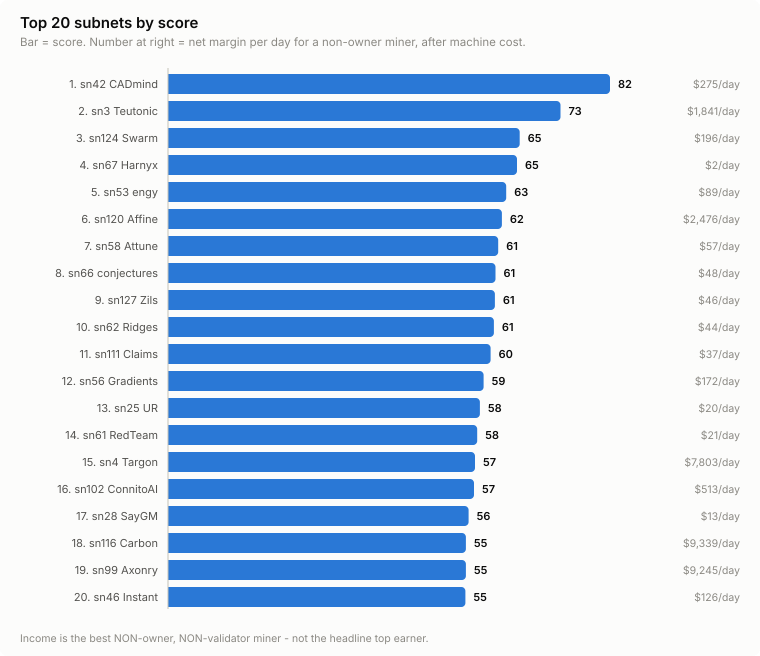

# Subnet watch — dashboard

_snapshot 2026-11-25T14:12:23Z · block 9584323 · run_status **ok**_

> Numbers here are quotable. Income is always `competitive_miner_usd_day` —
> the best miner that is neither the owner nor validator-permitted.

## The one number

# 51 of 128

subnets are worth looking at: not 100% burned, registration open, and the
competitive miner out-earns the cheapest machine that meets the requirement.

| | count | meaning |
|---|---:|---|
| Total subnets | 128 | everything on chain |
| Pays miners at all | 103 | `miner_burn` < 0.99 |
| Ranked | 103 | passed every gate |
| **Positive margin** | **51** | income beats machine cost |
| New events this window | 17 | see ALARMS.md |

## Where miner emission goes

The distribution is bimodal — subnets either burn nothing or burn everything.
There is very little middle ground, which is why burn is a gate and not a score.

| miner_burn | subnets | |
|---|---:|---|
| 0 (none) | 73 | `████████████████████████████` |
| 0–0.2 | 5 | `██` |
| 0.2–0.4 | 5 | `██` |
| 0.4–0.6 | 3 | `█` |
| 0.6–0.8 | 9 | `███` |
| 0.8–0.99 | 8 | `███` |
| ≥0.99 dead | 25 | `██████████` |

## Top 20

| # | subnet | score | net $/day (median) | ceiling $/day | machine | earners | top-1 share |
|---:|---|---:|---:|---:|---|---:|---:|
| 1 | sn42 CADmind | 80.9 | 198 | 198 = | cpu-small | 5 | 20% |
| 2 | sn120 Affine | 74.2 | 2,597 | 2,597 = | rtx4090* | 7 | 14% |
| 3 | sn3 Teutonic | 72.7 | 1,691 | 3,372 | rtx4090* | 4 | 40% |
| 4 | sn53 engy | 69.6 | 666 | 3,242 | rtx4090 | 8 | 49% |
| 5 | sn124 Swarm | 66 | 234 | 1,039 | rtx4090* | 10 | 28% |
| 6 | sn67 Harnyx | 63.5 | 1.45 | 383 | cpu-small | 105 | 31% |
| 7 | sn66 conjectures | 61.6 | 59.51 | 727 | rtx4090* | 4 | 80% |
| 8 | sn127 Zils | 61.4 | 56.00 | 61.14 | rtx4090 | 7 | 74% |
| 9 | sn58 Attune | 60.9 | 50.78 | 1,455 | rtx4090* | 57 | 30% |
| 10 | sn111 Claims | 59.6 | 33.48 | 138 | rtx4090* | 4 | 88% |
| 11 | sn62 Ridges | 59.6 | 32.71 | 347 | rtx4090* | 47 | 10% |
| 12 | sn56 Gradients | 58.4 | 155 | 2,928 | a100-80 | 7 | 43% |
| 13 | sn28 SayGM | 58.3 | 24.47 | 2,781 | rtx4090* | 95 | 26% |
| 14 | sn61 RedTeam | 58.1 | 21.88 | 41.03 | rtx4090* | 86 | 2% |
| 15 | sn25 UR | 57.8 | 18.75 | 18.75 = | rtx4090* | 10 | 45% |
| 16 | sn102 ConnitoAI | 56.6 | 473 | 476 | rtx4090* | 4 | 25% |
| 17 | sn116 Carbon | 55 | 7,867 | 7,867 = | rtx4090* | 1 | 100% |
| 18 | sn99 Axonry | 54.8 | 7,259 | 7,259 = | rtx4090* | 1 | 100% |
| 19 | sn46 Instant | 54.3 | 94.08 | 114 | cpu-small | 12 | 19% |
| 20 | sn38 ChronoLLM | 54.2 | 99.24 | 252 | cpu-small | 6 | 53% |

`=` after the ceiling means it equals the median exactly - either one competitive
miner exists, or they all earn the same. Both columns use identical precision;
if they ever disagree the data is wrong, since a median cannot exceed its own max.

`net $/day (median)` is what a newcomer should expect: the MEDIAN non-owner,
non-permitted miner, minus machine cost. `ceiling $/day` is the BEST competitive
miner - reachable only by beating everyone already there. Where the two diverge
wildly, the subnet is winner-take-all and the ceiling is not a plan.

`*` = machine is an assumed default; no hardware evidence was found for that subnet.

## Concentration — reported, never scored

A low top-1 share means many miners share the emission. A high one means a
single UID takes almost everything, so the headline income is not reachable.
**This is deliberately excluded from the score** — judge the shape yourself.

| top-1 share | subnets (of those that pay) |
|---|---:|
| wide (<30%) | 25 |
| concentrated (30–60%) | 21 |
| dominated (60–90%) | 25 |
| captured (>90%) | 28 |

## Hardware evidence quality

Most subnets do not state a requirement anywhere machine-readable, so their
margin assumes a default box. Treat those as indicative.

| basis | subnets |
|---|---:|
| no evidence | 98 |
| README keywords (GUESS) | 12 |
| min_compute.yml (curated) | 10 |
| code-submission (validator runs it) | 8 |

## Recent changes (last 7 days)

| when | subnet | class | what |
|---|---|---|---|
| 2026-11-25T14:12 | sn12 | RELEASE | sn12 released validator-staging-2026-11-25-45557483497-637-1: feat: al |
| 2026-11-25T14:12 | sn22 | SCORING_COMMIT | sn22 commit touches scoring: fix(task-api): the signed log, anchors, v |
| 2026-11-25T14:12 | sn25 | SCORING_COMMIT | sn25 commit touches scoring: Merge docs/validator-data-grant-1125: the |
| 2026-11-25T14:12 | sn26 | SCORING_COMMIT | sn26 commit touches scoring: Report: round the displayed score |
| 2026-11-25T14:12 | sn28 | RELEASE | sn28 released v0.6.1 |
| 2026-11-25T14:12 | sn40 | SCORING_COMMIT | sn40 commit touches scoring: Merge pull request #20 from RalphLabsAI/f |
| 2026-11-25T14:12 | sn40 | README_TASK_DIFF | sn40 README task/scoring sections changed |
| 2026-11-25T14:12 | sn51 | RELEASE | sn51 released executor-v1.198 |
| 2026-11-25T14:12 | sn51 | SCORING_COMMIT | sn51 commit touches scoring: DAH-6967 - [P3] Validator: a rented pod r |
| 2026-11-25T14:12 | sn56 | SCORING_COMMIT | sn56 commit touches scoring: Update roadmap: reward split and GRPO tas |
| 2026-11-25T14:12 | sn67 | SCORING_COMMIT | sn67 commit touches scoring: chore(validator): bump repo-owned validat |
| 2026-11-25T14:12 | sn71 | SCORING_COMMIT | sn71 commit touches scoring: Merge pull request #1374 from leadpoet/do |
| 2026-11-25T14:12 | sn91 | README_TASK_DIFF | sn91 README task/scoring sections changed |
| 2026-11-25T14:12 | sn94 | SCORING_COMMIT | sn94 commit touches scoring: Check the signed approved list in verify_ |
| 2026-11-25T14:12 | sn99 | SCORING_COMMIT | sn99 commit touches scoring: Evaluation machines hold the benchmarks o |

---

_Regenerated every sweep. Charts are SVG and follow the same numbers._

