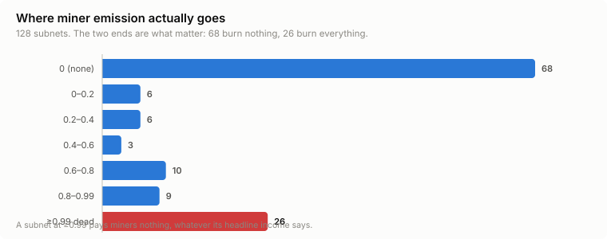

# Subnet watch — dashboard

_snapshot 2026-11-25T03:48:27Z · block 9581203 · run_status **ok**_

> Numbers here are quotable. Income is always `competitive_miner_usd_day` —
> the best miner that is neither the owner nor validator-permitted.

## The one number

# 51 of 128

subnets are worth looking at: not 100% burned, registration open, and the
competitive miner out-earns the cheapest machine that meets the requirement.

| | count | meaning |
|---|---:|---|
| Total subnets | 128 | everything on chain |
| Pays miners at all | 103 | `miner_burn` < 0.99 |
| Ranked | 103 | passed every gate |
| **Positive margin** | **51** | income beats machine cost |
| New events this window | 12 | see ALARMS.md |

## Where miner emission goes

The distribution is bimodal — subnets either burn nothing or burn everything.
There is very little middle ground, which is why burn is a gate and not a score.

| miner_burn | subnets | |
|---|---:|---|
| 0 (none) | 70 | `████████████████████████████` |
| 0–0.2 | 7 | `███` |
| 0.2–0.4 | 6 | `██` |
| 0.4–0.6 | 3 | `█` |
| 0.6–0.8 | 8 | `███` |
| 0.8–0.99 | 9 | `████` |
| ≥0.99 dead | 25 | `██████████` |

## Top 20

| # | subnet | score | net $/day (median) | ceiling $/day | machine | earners | top-1 share |
|---:|---|---:|---:|---:|---|---:|---:|
| 1 | sn42 CADmind | 81.2 | 211 | 211 = | cpu-small | 5 | 20% |
| 2 | sn3 Teutonic | 72.9 | 1,757 | 3,522 | rtx4090* | 4 | 40% |
| 3 | sn124 Swarm | 66.2 | 244 | 1,085 | rtx4090* | 10 | 28% |
| 4 | sn67 Harnyx | 64.7 | 2.30 | 242 | cpu-small | 119 | 19% |
| 5 | sn66 conjectures | 64.3 | 134 | 761 | rtx4090* | 3 | 81% |
| 6 | sn120 Affine | 62.4 | 2,703 | 2,703 = | rtx4090* | 7 | 14% |
| 7 | sn53 engy | 61.9 | 64.73 | 799 | rtx4090 | 20 | 61% |
| 8 | sn58 Attune | 61.1 | 53.14 | 1,513 | rtx4090* | 57 | 30% |
| 9 | sn127 Zils | 60.7 | 45.44 | 64.21 | rtx4090 | 6 | 83% |
| 10 | sn111 Claims | 59.8 | 35.43 | 145 | rtx4090* | 4 | 88% |
| 11 | sn62 Ridges | 59.8 | 34.63 | 364 | rtx4090* | 47 | 10% |
| 12 | sn56 Gradients | 58.6 | 163 | 3,056 | a100-80 | 7 | 43% |
| 13 | sn61 RedTeam | 58 | 21.47 | 40.56 | rtx4090* | 92 | 2% |
| 14 | sn25 UR | 58 | 20.05 | 20.05 = | rtx4090* | 10 | 45% |
| 15 | sn4 Targon | 56.7 | 7,075 | 17,797 | rtx4090* | 3 | 67% |
| 16 | sn102 ConnitoAI | 56.7 | 493 | 497 | rtx4090* | 4 | 25% |
| 17 | sn28 SayGM | 55.9 | 12.91 | 2,167 | rtx4090* | 98 | 36% |
| 18 | sn116 Carbon | 55.2 | 8,585 | 8,585 = | rtx4090* | 1 | 100% |
| 19 | sn38 ChronoLLM | 54.4 | 104 | 263 | cpu-small | 6 | 53% |
| 20 | sn46 Instant | 53.8 | 79.27 | 85.50 | cpu-small | 15 | 20% |

`=` after the ceiling means it equals the median exactly - either one competitive
miner exists, or they all earn the same. Both columns use identical precision;
if they ever disagree the data is wrong, since a median cannot exceed its own max.

`net $/day (median)` is what a newcomer should expect: the MEDIAN non-owner,
non-permitted miner, minus machine cost. `ceiling $/day` is the BEST competitive
miner - reachable only by beating everyone already there. Where the two diverge
wildly, the subnet is winner-take-all and the ceiling is not a plan.

`*` = machine is an assumed default; no hardware evidence was found for that subnet.

## Concentration — reported, never scored

A low top-1 share means many miners share the emission. A high one means a
single UID takes almost everything, so the headline income is not reachable.
**This is deliberately excluded from the score** — judge the shape yourself.

| top-1 share | subnets (of those that pay) |
|---|---:|
| wide (<30%) | 26 |
| concentrated (30–60%) | 20 |
| dominated (60–90%) | 24 |
| captured (>90%) | 29 |

## Hardware evidence quality

Most subnets do not state a requirement anywhere machine-readable, so their
margin assumes a default box. Treat those as indicative.

| basis | subnets |
|---|---:|
| no evidence | 98 |
| README keywords (GUESS) | 12 |
| min_compute.yml (curated) | 10 |
| code-submission (validator runs it) | 8 |

## Recent changes (last 7 days)

| when | subnet | class | what |
|---|---|---|---|
| 2026-11-25T03:48 | sn25 | SCORING_COMMIT | sn25 commit touches scoring: Merge docs/validator-rate-class-1125: the |
| 2026-11-25T03:48 | sn51 | SCORING_COMMIT | sn51 commit touches scoring: DAH-6876 - [P4] Validator: our own s3fs v |
| 2026-11-25T03:48 | sn53 | SCORING_COMMIT | sn53 commit touches scoring: Merge pull request #68 from hanlinai/feat |
| 2026-11-25T03:48 | sn56 | SCORING_COMMIT | sn56 commit touches scoring: Remove organic task endpoints and unused  |
| 2026-11-25T03:48 | sn66 | RELEASE | sn66 released v2026.11.25 |
| 2026-11-25T03:48 | sn70 | RELEASE | sn70 released image-v2026.11.24 (SUPERSEDED by image-v2026.11.24b, do  |
| 2026-11-25T03:48 | sn70 | SCORING_COMMIT | sn70 commit touches scoring: v5: pay miners half the miner emission; t |
| 2026-11-25T03:48 | sn71 | SCORING_COMMIT | sn71 commit touches scoring: Advance a verified settled pilot into one |
| 2026-11-25T03:48 | sn91 | SCORING_COMMIT | sn91 commit touches scoring: fix(validator): offloaded bench sweeps re |
| 2026-11-25T03:48 | sn91 | README_TASK_DIFF | sn91 README task/scoring sections changed |
| 2026-11-25T03:48 | sn111 | SCORING_COMMIT | sn111 commit touches scoring: Include replay driver used by scientific |
| 2026-11-25T03:48 | sn116 | SCORING_COMMIT | sn116 commit touches scoring: Motor 1.8 switch: the miner texts that s |
| 2026-11-24T20:45 | sn12 | RELEASE | sn12 released validator-staging-2026-11-24-45412581463-636-1: feat: ad |
| 2026-11-24T20:45 | sn39 | SCORING_COMMIT | sn39 commit touches scoring: Merge pull request #34 from kokoahdotcom/ |
| 2026-11-24T20:45 | sn42 | SCORING_COMMIT | sn42 commit touches scoring: miner prompt: a community model comes fro |

---

_Regenerated every sweep. Charts are SVG and follow the same numbers._

