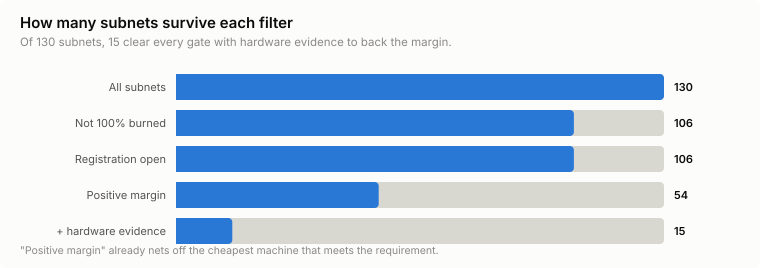

# Subnet watch — dashboard

_snapshot 2026-11-14T15:44:53Z · block 9505612 · run_status **ok**_

> Numbers here are quotable. Income is always `competitive_miner_usd_day` —
> the best miner that is neither the owner nor validator-permitted.

## The one number

# 60 of 128

subnets are worth looking at: not 100% burned, registration open, and the
competitive miner out-earns the cheapest machine that meets the requirement.

| | count | meaning |
|---|---:|---|
| Total subnets | 128 | everything on chain |
| Pays miners at all | 102 | `miner_burn` < 0.99 |
| Ranked | 102 | passed every gate |
| **Positive margin** | **60** | income beats machine cost |
| New events this window | 8 | see ALARMS.md |

## Where miner emission goes

The distribution is bimodal — subnets either burn nothing or burn everything.
There is very little middle ground, which is why burn is a gate and not a score.

| miner_burn | subnets | |
|---|---:|---|
| 0 (none) | 69 | `████████████████████████████` |
| 0–0.2 | 4 | `██` |
| 0.2–0.4 | 6 | `██` |
| 0.4–0.6 | 3 | `█` |
| 0.6–0.8 | 12 | `█████` |
| 0.8–0.99 | 8 | `███` |
| ≥0.99 dead | 26 | `███████████` |

## Top 20

| # | subnet | score | net $/day (median) | ceiling $/day | machine | earners | top-1 share |
|---:|---|---:|---:|---:|---|---:|---:|
| 1 | sn42 CADmind | 81.9 | 257 | 257 = | cpu-small | 5 | 20% |
| 2 | sn97 Ingot | 71.8 | 1,257 | 1,257 = | rtx4090* | 5 | 20% |
| 3 | sn56 Gradients | 70.1 | 771 | 4,071 | rtx4090* | 6 | 50% |
| 4 | sn34 Yugos | 69.7 | 688 | 5,907 | rtx4090* | 3 | 85% |
| 5 | sn58 Attune | 68.9 | 530 | 854 | rtx4090* | 5 | 70% |
| 6 | sn41 Almanac | 68.2 | 8.73 | 122 | cpu-small | 154 | 2% |
| 7 | sn67 Harnyx | 67.2 | 5.68 | 205 | cpu-small | 125 | 16% |
| 8 | sn124 Swarm | 65.4 | 194 | 811 | rtx4090* | 10 | 31% |
| 9 | sn15 ORO | 65 | 6.03 | 12.90 | cpu-small | 71 | 95% |
| 10 | sn53 engy | 64.9 | 161 | 6,660 | rtx4090 | 23 | 40% |
| 11 | sn38 ChronoLLM | 63.3 | 48.58 | 335 | cpu-small | 9 | 52% |
| 12 | sn120 Affine | 62 | 2,378 | 2,378 = | rtx4090* | 10 | 10% |
| 13 | sn121 sundae_bar | 61.4 | 764 | 764 = | cpu-small | 2 | 60% |
| 14 | sn111 Claims | 60.4 | 41.77 | 167 | rtx4090* | 4 | 88% |
| 15 | sn62 Ridges | 59.8 | 34.78 | 626 | rtx4090* | 44 | 15% |
| 16 | sn4 Targon | 57.8 | 9,641 | 20,676 | rtx4090* | 5 | 62% |
| 17 | sn102 ConnitoAI | 57.3 | 577 | 580 | rtx4090* | 4 | 25% |
| 18 | sn5 Hone | 57 | 19.34 | 42.32 | rtx4090* | 243 | 1% |
| 19 | sn66 conjectures | 56.4 | 11.97 | 978 | rtx4090* | 7 | 81% |
| 20 | sn1 Apex | 55.3 | 316 | 624 | rtx4090* | 4 | 66% |

`=` after the ceiling means it equals the median exactly - either one competitive
miner exists, or they all earn the same. Both columns use identical precision;
if they ever disagree the data is wrong, since a median cannot exceed its own max.

`net $/day (median)` is what a newcomer should expect: the MEDIAN non-owner,
non-permitted miner, minus machine cost. `ceiling $/day` is the BEST competitive
miner - reachable only by beating everyone already there. Where the two diverge
wildly, the subnet is winner-take-all and the ceiling is not a plan.

`*` = machine is an assumed default; no hardware evidence was found for that subnet.

## Concentration — reported, never scored

A low top-1 share means many miners share the emission. A high one means a
single UID takes almost everything, so the headline income is not reachable.
**This is deliberately excluded from the score** — judge the shape yourself.

| top-1 share | subnets (of those that pay) |
|---|---:|
| wide (<30%) | 25 |
| concentrated (30–60%) | 18 |
| dominated (60–90%) | 34 |
| captured (>90%) | 24 |

## Hardware evidence quality

Most subnets do not state a requirement anywhere machine-readable, so their
margin assumes a default box. Treat those as indicative.

| basis | subnets |
|---|---:|
| no evidence | 98 |
| README keywords (GUESS) | 11 |
| min_compute.yml (curated) | 10 |
| code-submission (validator runs it) | 8 |
| README stated VRAM (explicit) | 1 |

## Recent changes (last 7 days)

| when | subnet | class | what |
|---|---|---|---|
| 2026-11-14T15:45 | sn25 | RELEASE | sn25 released v2026.11.14-1098667430 |
| 2026-11-14T15:45 | sn25 | SCORING_COMMIT | sn25 commit touches scoring: Merge fix/validator-attempt-upload-lane-r |
| 2026-11-14T15:45 | sn42 | RELEASE | sn42 released v0.6.13 |
| 2026-11-14T15:45 | sn42 | SCORING_COMMIT | sn42 commit touches scoring: tests: stub the agent CLI checks where th |
| 2026-11-14T15:45 | sn53 | SCORING_COMMIT | sn53 commit touches scoring: tee_miner: forward reported cache write t |
| 2026-11-14T15:45 | sn56 | SCORING_COMMIT | sn56 commit touches scoring: Bind subnet API publicly and add task sub |
| 2026-11-14T15:45 | sn81 | SCORING_COMMIT | sn81 commit touches scoring: fix(miner): stop agentic children gracefu |
| 2026-11-14T15:45 | sn94 | SCORING_COMMIT | sn94 commit touches scoring: Alert the miner operator on a first misse |
| 2026-11-14T08:55 | sn25 | SCORING_COMMIT | sn25 commit touches scoring: Merge release/validator-1114-idle-fleet:  |
| 2026-11-14T08:55 | sn94 | SCORING_COMMIT | sn94 commit touches scoring: Admit miner hotels on a declared capacity |
| 2026-11-14T08:55 | sn108 | BURN_DROP | sn108 burn fell 1.000 -> 0.800 - miners can earn again |
| 2026-11-14T08:55 | sn116 | SCORING_COMMIT | sn116 commit touches scoring: Re-class: replace the miner-facing marke |
| 2026-11-14T01:52 | sn5 | SCORING_COMMIT | sn5 commit touches scoring: Lengthen the new-miner ramp to 30 observat |
| 2026-11-14T01:52 | sn8 | SCORING_COMMIT | sn8 commit touches scoring: Put new regular miners on the static drawd |
| 2026-11-14T01:52 | sn42 | RELEASE | sn42 released v0.6.11 |

---

_Regenerated every sweep. Charts are SVG and follow the same numbers._

