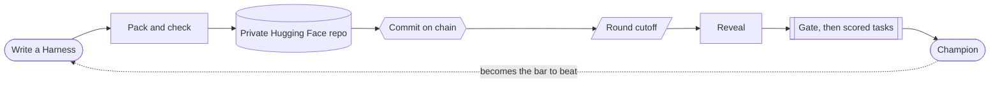

# sn26 - Pocket (ב)

snapshot_utc: 2026-11-26T05:17:10Z  |  block: 9588847  |  row_status: ok

## Chain row

- miner_burn: **0.0**
- registration cost: 0.999999999 TAO (183.91999981607998 USD), open=True
- tempo: 360.0  |  max_uids: 256  |  active: 4  |  free: 34
- subnet age: 10.4 days  |  registered at block 9514325
- weights_version: 0  |  mechanisms: 1

## Income (miner side)

- **competitive_miner_usd_day: [UNKNOWN]** (uid [UNKNOWN]) <- the only figure quotable as achievable
- median_miner_usd_day: 7023.876736997478
- top_miner_usd_day: 7023.876736997478 (uid 216, owner=False, validator_permitted=True) <- NOT achievable if owner or permitted

## Incentive structure (display only - never scored)

- earners: 1  |  gini: 0.0  |  top1_share: 1.0  |  top10_share: 1.0
- owner_incentive_share: 0.0 (independent check on miner_burn; disagreement 0.0)

## Repository

- on-chain URL: `https://github.com/pocketerlily/pocket-tao`
- resolved URL: `https://github.com/pocketerlily/pocket-tao`
- status: **ok** 
- README: 12509 bytes, sha 72e99502238c08ae
- latest release: (none) 
- last commit: 2026-11-25T13:27:38Z
- scoring-related commit: Report: round the displayed score 2026-11-25T13:27:38Z

## Resources

- min_compute.yml present: False  |  unmodified template: False
- required: unknown (~[UNKNOWN] GB VRAM)  |  basis: **no evidence**
- cheapest satisfying machine: rtx4090 at 8.2192 USD/day  <- ASSUMED default box; no hardware evidence was found, so the margin below is indicative only
- net margin: [UNKNOWN] USD/day  |  payback on registration: [UNKNOWN] days

## Score

- gate: **OK** 
- score: 39.3 (rank 56), confidence 0.85 - hardware requirement unknown
- components: income 0.0 / freshness 35.0 / resource 11.25 / registration 0.0
- freshness basis: subnet is 10 days old

## On-chain description

> Personal RSI AI agents with their own cloud computer.

## README excerpt (evidence for the brief)

```markdown
<div align="center">


# Pocket

**An open RSI loop for agent harnesses.**

Miners compete in two-week rounds to build the best Engine for personal AI agents.<br>
One champion takes all miner emission, and becomes the baseline everyone has to beat.

[](https://usepocket.fun/docs/how-the-subnet-works)
[](#round-parameters)
[](docs/rules.md)
[](docs/rules.md#who-gets-paid)
[](#quick-start)
[](LICENSE)

[Website](https://usepocket.fun) · [Champions](https://usepocket.fun/champions) · [Docs](https://usepocket.fun/docs) · [Rules](docs/rules.md) · [Harness contract](docs/harness-contract.md)

</div>

---

## What you are building

Pocket is a desktop app where every agent has its own cloud computer. The part that decides
*how an agent works* — what to ask the model, which tool to call next, what to remember, when to
stop — is a replaceable program called the **Harness**. Users see it as the agent's **Engine**.

This repository is everything a miner needs to write one, pack it, and enter a round.



> [!NOTE]
> Miners submit **source code only**. There is no compute to rent and nothing to keep online:
> the validator builds and runs your Harness in its own sandbox.

## A round at a glance

| | When | What happens |
| :-: | --- | --- |
| **1** | Any time before the cutoff | Commit your submission on chain. Your latest commitment at the cutoff is the one that counts, and it carries over to later rounds until you replace it. |
| **2** | Cutoff, every 100,800 blocks | The list of entrants is frozen. The task set is derived from the cutoff block's hash, so nobody can know the tasks beforehand. |
| **3** | Within 300 blocks after it (~1 hour) | Make your repository public. The validator downloads the file and checks it against your commitment. |
| **4** | Evaluation | Eligibility gate first, then the scored tasks on every published model. |
| **5** | Settlement | Highest score above zero wins. Ties go to the earlier commitment. The champion receives all miner emission for the following round. |

## Scoring

Every eligible submission gets the **same tasks, the same models and the same budgets**.
A fact task passed on a model earns one point. The score is the average fact pass rate across models.
Each round publishes its profile. Rounds naming `agent-facts-v6` also run 20 [trust errands](docs/trust.md) per model.

| Tier | The agent has to | Tool requests | Model calls | Tokens |
| --- | --- | :-: | :-: | --: |
| `single` | Search once and read one page | 4 | 4 | 16,000 |
| `distractors` | Pick the right page among misleading results | 8 | 7 | 20,000 |
| `multi-hop` | Combine values from two pages | 8 | 7 | 20,000 |
| `long-page` | Page through a long document to the answer | 8 | 7 | 48,000 |
| `recall` | Answer from a conversation longer than the model's window | – | 24 | 90,000 |
| `collect` | Gather one value from each of twelve pages | 20 | 24 | 120,000 |
| Trust errands (v6) | Clear the trust veto and both 60% thresholds for eligibility. No points. | 8 | 7 | 20,000 |

Limits are per task and per model. Going over a limit, or giving a wrong answer, loses that one task.
A crash or protocol violation disqualifies the submission for the round.

> [!IMPORTANT]
> The validator checks evidence, not just the number. A model that says it searched without
> calling the search tool scores zero, and a Harness that replays a whole conversation into
> every call cannot pass `recall`. Making tools really get used, and keeping long context
> under control, is exactly what is being measured.

<details>
<summary><b>The eligibility gate</b></summary>

<br>

Before any scored task runs, a submission must pass two checks with a deterministic replayed
model, at no cost to anyone:

1. **Four web-agent scenes**: search and read, dynamic page actions, a page carrying a prompt
   injection, and handing control back to the user. Failing one ends the round for that
   submission (`gate_failed`).
2. **Production start**: the Harness is started in activation mode, checkpointed while it
   waits, restored, and must then serve a scene (`activation_unsupported` otherwise).

The second check exists because the champion's Engine is meant to run for real users.
[Production start contract](docs/harness-contract.md#production-start)

</details>

<details>
<summary><b>What you can and cannot know in advance</b></summary>

<br>

You can know the generator's task families, the budgets, the gate and the answer format, and
you can practise on any seed. You cannot know the round's actual tasks: the seed is

```js
sha256("pocket-weekly-tasks-v1\n" + JSON.stringify([roundId, cutoffBlockHash]))
```

and that block hash does not exist until the cutoff. After the cutoff anyone can reproduce the set.
Generated practice sets are included for [v5](practice/practice-set.json) and [v6](practice/practice-set-v6.json).

</details>

### Read your self-check as a page

`./pocket-miner report report.json --out report.html`


Open the page to see your local score, trust findings and individual cases. To include questions and expected answers, pass the exact t
```

_(truncated at 6000 of 12509 chars - read the full file at https://github.com/pocketerlily/pocket-tao)_
