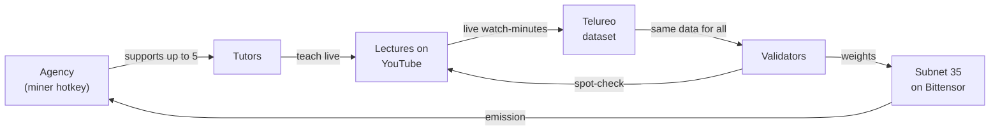

# sn35 - TTedu (ך)

snapshot_utc: 2026-11-28T17:49:50Z  |  block: 9607010  |  row_status: ok

## Chain row

- miner_burn: **0.7000032046344131**
- registration cost: 0.1 TAO (18.064 USD), open=True
- tempo: 360.0  |  max_uids: 256  |  active: 4  |  free: 0
- subnet age: 16.9 days  |  registered at block 9485521
- weights_version: 0  |  mechanisms: 1

## Income (miner side)

- **competitive_miner_usd_day: 3917.136625065569** (uid 70) <- the only figure quotable as achievable
- median_miner_usd_day: 6528.627456435581
- top_miner_usd_day: 9140.118287805592 (uid 0, owner=True, validator_permitted=True) <- NOT achievable if owner or permitted

## Incentive structure (display only - never scored)

- earners: 2  |  gini: 0.20000305185094747  |  top1_share: 0.7000030518509476  |  top10_share: 1.0
- owner_incentive_share: 0.7000030518509476 (independent check on miner_burn; disagreement 0.0)

## Repository

- on-chain URL: `https://github.com/telureo/ttedu-subnet`
- resolved URL: `https://github.com/telureo/ttedu-subnet`
- status: **ok** 
- README: 10304 bytes, sha 22e198435fd661ca
- latest release: TTedu 0.4.0 2026-11-27T21:18:20Z
- last commit: 2026-11-28T04:45:21Z
- scoring-related commit: The validator guide says how to publish the Google app, so the YouTub… 2026-11-28T04:12:36Z

## Resources

- min_compute.yml present: True  |  unmodified template: False
- required: cpu-only (~0 GB VRAM)  |  basis: **min_compute.yml (curated)**
- cheapest satisfying machine: cpu-small at 0.9863 USD/day
- net margin: 3916.1503 USD/day  |  payback on registration: 0.0 days

## Score

- gate: **OK** 
- score: 78.8 (rank 2), confidence 0.85 - income rests on 1 competitive miner (n<=2: not a distribution)
- components: income 32.68 / freshness 35.0 / resource 15.0 / registration 10.0
- freshness basis: subnet is 17 days old

## On-chain description

> The incentive layer for teaching. Tutor agencies compete on the live audience of their tutors' lectures on Telureo, and validators reward each agency by its share.

## README excerpt (evidence for the brief)

```markdown
<div align="center">

<picture>
  <source media="(prefers-color-scheme: dark)" srcset="docs/assets/ttedu-symbol-dark.svg">
  
</picture>

# **TTedu** <!-- omit in toc -->

### Bittensor subnet 35, the incentive layer for teaching <!-- omit in toc -->

[](https://github.com/telureo/ttedu-subnet/actions/workflows/ci.yml)
[](LICENSE)
[](pyproject.toml)
[](https://github.com/opentensor/bittensor)

[Leaderboard](https://subnet.telureo.com) • [Telureo](https://telureo.com) • [Docs](https://docs.telureo.com) • [Whitepaper](https://docs.telureo.com/whitepaper/) • [X](https://x.com/TTeduSubnet) • [taostats](https://taostats.io/subnets/35)

</div>

---

- [Introduction](#introduction)
- [How it works](#how-it-works)
- [Incentive mechanism](#incentive-mechanism)
- [Repository layout](#repository-layout)
- [Installation](#installation)
- [Run an agency (miner)](#run-an-agency-miner)
- [Run a validator](#run-a-validator)
- [Trust](#trust)
- [Roadmap](#roadmap)
- [Contributing](#contributing)
- [Links](#links)
- [License](#license)

---

## Introduction

TTedu is the Bittensor subnet behind [Telureo](https://telureo.com), a platform for free live education. Tutors teach live lectures on Telureo's YouTube channels, and anyone can watch them for free.

On TTedu, **a miner is a tutor agency**. Each miner hotkey supports up to 5 tutors. **Validators** score every agency by the live audience its tutors' lectures attract, and the network rewards each agency by its share.

So the way to earn on TTedu is to find good teachers and help them teach lectures that people choose to watch live.

This repository holds everything agencies and validators run or may want to check: the incentive rules, the data formats, and the `ttedu` command line.

## How it works



1. An agency registers a hotkey on subnet 35 and brings tutors to Telureo.
2. Its tutors book and teach live lectures on Telureo's YouTube channels.
3. YouTube reports each lecture's live watch-minutes. Telureo collects them and serves them to validators as one dataset.
4. Every validator scores that dataset with the code in this repository, checks numbers against YouTube, and sets weights.
5. The chain pays each agency by the weight validators agree on.

## Incentive mechanism

The full rules, with a worked example, are in [docs/incentive_mechanism.md](docs/incentive_mechanism.md). In short:

- **Only live viewing counts.** The measure is YouTube's LIVE `estimatedMinutesWatched` for the lecture. Replays never count, and there is no cap.
- **Every lecture gets the same 72 hours.** Telureo starts checking YouTube 48 hours after a lecture actually ends, every 30 minutes. YouTube's first answer opens the lecture's 72-hour scoring window, however late that answer comes.
- **The score is YouTube's latest number.** During the 72 hours the number is read every 30 minutes, and each reading replaces the last. A number read 60 minutes ago or more doesn't count until a new one arrives.
- **No answer, no score.** A lecture YouTube hasn't answered for within 7 days of checking is never counted.
- **From minutes to weight.** An agency's score is the sum of its lectures' scores. Its share is its score divided by the total of all agencies' scores, in exact arithmetic.
- **Burn rate.** TTedu is in its test phase, with few agencies so far. During it, 70% of the weight is burned: it goes to the subnet owner's UID. The other 30% is shared among the agencies by their shares.
- **Nothing to reward.** When every score is zero, or a validator can't get a valid dataset, the validator burns everything.

A lecture belongs to the miner registration (the hotkey and the block it registered at) its tutor belonged to when the lecture was booked. It never moves to another miner.

## Repository layout

```text
ttedu-subnet/
├── src/edu_subnet/        The package
│   ├── scoring.py         The incentive mechanism: lecture scores, miner weights, burn
│   ├── timing.py          The clock: checks from 48 hours, the 72-hour window, freshness
│   ├── dataset.py         The validator dataset Telureo serves, and how it is parsed
│   ├── metric.py          The measured quantity and the exact YouTube Analytics query
│   ├── validator.py       The validator loop: download, score, set weights, spot-check
│   ├── chain.py           The metagraph and weight submission
│   ├── youtube.py         A validator's own read-only YouTube access, for spot-checks
│   ├── protocol.py        Signed requests and the tutor-authorization message
│   ├── signing.py         Signing and verifying with Bittensor keys
│   ├── client.py          The client for Telureo's API
│   └── cli.py             The ttedu command line
├── neurons/               Entry points: validator.py and miner.py
├── docs/                  Guides for agencies and validators, the mechanism, the API
├── scripts/               Install script and a systemd unit for validators
├── tests/                 The test suite
├── contrib/               How to contribute
└── min_compute.yml        What an agency and a validator need to run
```

## Installation

You need Python 3.11 or newer and a Bittensor wallet.

```bash
git clone https://github.com/telureo/ttedu-subnet.git
cd ttedu-subnet
scripts/install.sh            # creates .venv and installs ttedu in it
source .ve
```

_(truncated at 6000 of 10304 chars - read the full file at https://github.com/telureo/ttedu-subnet)_
