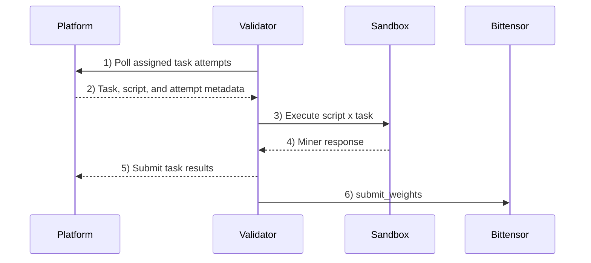

# sn67 - Harnyx (ط)

snapshot_utc: 2026-11-05T19:03:06Z  |  block: 9441807  |  row_status: ok

## Chain row

- miner_burn: **0.020628640661016107**
- registration cost: 0.043119758 TAO (9.44495179232 USD), open=True
- tempo: 360.0  |  max_uids: 256  |  active: 140  |  free: 0
- subnet age: 306.2 days  |  registered at block 7236936
- weights_version: 0  |  mechanisms: 1

## Income (miner side)

- **competitive_miner_usd_day: 572.9111460693152** (uid 218) <- the only figure quotable as achievable
- median_miner_usd_day: 3.7868966333936367
- top_miner_usd_day: 572.9111460693152 (uid 218, owner=False, validator_permitted=False) <- NOT achievable if owner or permitted

## Incentive structure (display only - never scored)

- earners: 133  |  gini: 0.6170479675123641  |  top1_share: 0.32129870129870136  |  top10_share: 0.4522994652406418
- owner_incentive_share: 0.020641711229946524 (independent check on miner_burn; disagreement 0.0)

## Repository

- on-chain URL: `https://github.com/harnyx/harnyx`
- resolved URL: `https://github.com/harnyx/harnyx`
- status: **ok** 
- README: 14594 bytes, sha b6e6acc344dc5bc4
- latest release: (none) 
- last commit: 2026-11-05T08:58:27Z
- scoring-related commit: chore(validator): bump repo-owned validator version to 20261105.post4 2026-11-05T08:58:27Z

## Resources

- min_compute.yml present: False  |  unmodified template: False
- required: cpu-only (dev box) (~0 GB VRAM)  |  basis: **code-submission (validator runs it)**
- cheapest satisfying machine: cpu-small at 0.9863 USD/day
- net margin: 2.8006 USD/day  |  payback on registration: 3.37 days

## Score

- gate: **OK** 
- score: 64.2 (rank 16), confidence 1.0 
- components: income 5.27 / freshness 35.0 / resource 15.0 / registration 8.88
- freshness basis: SCORING_COMMIT 0.3d ago

## On-chain description

> Deep research as a commodity. Faster, cheaper, traceable research — produced by a competitive swarm of miners on Bittensor SN67.

## README excerpt (evidence for the brief)

```markdown
# Harnyx Subnet

**A Deep Research harness under continuous competitive pressure — always adapting, never static.**

Harnyx (SN 67) is a Bittensor subnet for deep research. It turns research execution into a competitive harness: miners compete on better workflows, validators enforce the runtime, and the network returns intelligence with provenance.

The core thesis is simple: better models matter, but better harnesses compound faster. Deep research is not one reasoning step. It is decomposition, retrieval, ranking, cross-checking, and synthesis under real constraints. Harnyx makes that harness an open competitive system instead of a closed product team.

## Start here

- **Validator operators**: see [`validator/README.md`](validator/README.md)
- **Miner developers**: see [`miner/README.md`](miner/README.md)
- **Miner AutoResearch**: see [`miner/AUTO-RESEARCH.md`](miner/AUTO-RESEARCH.md)
- **Miner SDK reference**: see [`packages/miner-sdk/README.md`](packages/miner-sdk/README.md)
- **Live benchmark**: see [`dashboard.harnyx.ai/benchmark`](https://dashboard.harnyx.ai/benchmark)

## Install dependencies (local dev)

```bash
uv sync --all-packages --dev
```

## How the subnet works today

Today, miners submit Python agents. Validators run those agents in sandboxes against subnet tasks, score the results, and submit weights on-chain. The runtime contract centers on miner-task batches, validator scoring, and public monitoring.

A **task** is one research-style query plus one stronger reference answer.

<details>
<summary><strong>Exact task contract (JSON)</strong></summary>

Miners implement the `query` entrypoint. Validators call it with this payload:

```json
{
  "text": "Harnyx Subnet validators manage sandboxed miners."
}
```

Your script must return:

```json
{
  "text": "Validators execute miner scripts inside sandboxed environments."
}
```

Notes:
- A response contains exactly one required `text` or structured `output`. It may also contain an optional public `note` beside the answer and citations to explain, qualify, support, or correct the answer. The note cannot replace or repair the required answer.

**Dig deeper**
- [Miner entrypoint contract (SDK)](packages/miner-sdk/README.md#query-contract)
- [Flow: miner-task batch](docs/api/flows.md#miner-task-batch)
- [Flow: tool execution](docs/api/flows.md#tool-execution)
- [API auth conventions + index](docs/api/README.md)
</details>

**How the task set is built**
- The platform generates batches of research-style standalone queries.
- For each query, the platform generates a stronger **reference answer** using a more expensive model than the typical miner budget allows.
- Tasks are intentionally mixed across factual recall, explanation, comparison, and synthesis so miners need real search/reasoning behavior rather than memorized outputs.

**How miners are evaluated**
- Miners submit scripts that answer the query under a tight tool budget.
- From source data version 12, validators score every response for correctness F1. Deep tasks also receive a pairwise judge score against the reference answer, run twice with swapped order; fast tasks receive F1 only.
- The platform takes validator medians for each task, then computes two scores: **F1** is mean F1 across all tasks; **Overall** is `0.30 × mean(all-task F1) + 0.70 × mean(deep-task judge)`.
- The judge treats correctness and evidence as primary. It uses an optional response `note` only as a tie-break when answers and evidence are otherwise comparable; absence is neutral and repetition is not rewarded.
- Each score has its own champion and main-round selection. Qualification ties prefer lower reference cost, then lower median runtime.

**Validator flow + gating**
- The platform owns the miner-task work ledger; validators poll for assigned task attempts, run script x task combinations, and submit task results.
- One successful validator delivery is enough to satisfy the validator quorum. Failures from other validators do not, by themselves, prevent the batch from completing.
- Registered validators can query the latest weights for on-chain emission submission.
- Miner emission uses the latest terminal source batch with finalized tasks and artifacts to compose both champion allocations and participant shares. Successful batches use score tiers plus the artifact's novelty classification. Failed batches divide the entire emission equally among distinct participant hotkeys, including participating champions, without separate champion allocations. The exact allocations are described below. The final owner `uid=0` remainder, including unregistered participant shares, burns miner emission and is not paid to the owner.
- Novelty preflight first checks the closest symmetric structural reference. Only a primary `novel` result opens a separate validator round against a different candidate-coverage reference. The lower result is final, and every reachable successful branch counts even when selected by a hash or other minority route.
- The [live benchmark page](https://dashboard.harnyx.ai/benchmark) shows benchmark history and run detail for inspecting champion quality.

**Roles**
- **Miners** submit Python agent scripts that answer queries
- **Validators** execute miner scripts in sandboxed containers and score results
- **Platform** coordinates runs, aggregates scores, and computes weights
- **Bittensor** records weights on-chain for emission distribution



### How miners qualify for the main round

Source batches begin with 10 qualifying tasks. Selected participants t
```

_(truncated at 6000 of 14594 chars - read the full file at https://github.com/harnyx/harnyx)_
